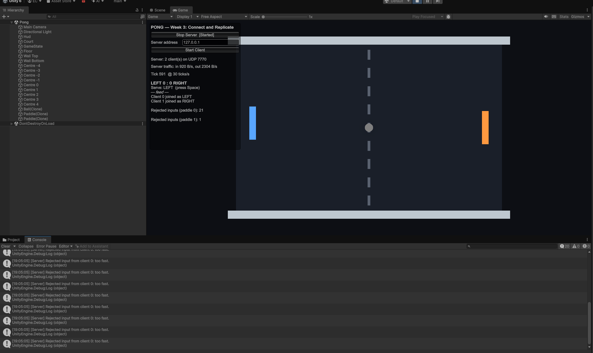

# Week 4 — Homework 2: The server decides

**Team Takla:** Yusuf Arda Göçer · Bora Deniz Nural · Efe Can Eser — Unity 6000.3.2f1 · FishNet 4.7.x · Tugboat UDP 7770 · tick rate 30

Our Homework 1 Pong with one change: the client no longer says "my paddle is here". It sends only its input (up, down, nothing) every tick, the **server** moves the paddle, and the server ignores a second input from the same client inside **30 ms**. All changes are in [`Pong/Assets/Scripts/Network/PaddleController.cs`](../Pong/Assets/Scripts/Network/PaddleController.cs) and in the Paddle prefab.

| Commit | Step |
|---|---|
| `Homework 2: start` | Homework 1 works (one ball, score, serve) |
| `Homework 2: client authority off` | Step 1 |
| `Homework 2: input up, position down` | Step 2 |
| `Homework 2: check the input (NaN, clamp, spectator)` | Step 3 |
| `Homework 2: rate limit 30 ms` | Step 4 |
| `Homework 2: cheat keys C, X, T (+ extra …)` | Step 5 + the ungraded extra |
| `Homework 2: done` | this README + screenshot |

**How we tested:** on one PC, 1 server + 2 clients as separate processes (the editor or a development build as server, development builds as clients, 127.0.0.1). The key presses (W/S, Space, C, X, T) were driven through Unity's Input System by a small throw-away test script, so the real `Update` / `OnTick` code ran; that script is not part of the project. Remote play over Tailscale was tested by the team in Homework 1 (RTT 27–33 ms).

---

## Step 1 — Client Authoritative off

Paddle prefab ▸ NetworkTransform ▸ *Client Authoritative* **off** (the Ball prefab was already off).

Observed: pressing W in a client moved the paddle only in that client's own window; the server never moved it and no other window saw it. That is correct: the server now owns the position and nobody had told it to move anything yet. With Client Authoritative on, the position went owner → server → others; now it goes **server → everyone, owner included**.

## Step 2 — Send the input, not the position

- `Update` no longer touches `transform` (the two movement/clamp lines are deleted); it keeps the owner guard and the Space / serve part.
- `OnStartNetwork` subscribes `TimeManager.OnTick += OnTick` (unsubscribed in `OnStopNetwork`, not in `Awake`).
- `OnTick`, in this order: **(1) owner sends** — read W/S or ↑/↓ into `axis` (+1, −1, 0) and call `ServerSetAxis(axis)` every tick, also when it is 0; **(2) server moves** — `transform.position += Vector3.forward * _serverAxis * speed * TickDelta`, then `Court.ClampPaddle`.
- `[ServerRpc] ServerSetAxis(float axis)` stores the input in the server-only field `_serverAxis`.

Observed: W in a client moves that paddle in every window, the owner's too, a little late. It moved at the normal 8 units/s and stopped at the wall (z = 4).

**RTT = our delay:** 11–17 ms on one PC (127.0.0.1); 27–33 ms between our laptops over Tailscale (Homework 1). My own paddle now reacts about one RTT later than before, plus the two-tick interpolation of the NetworkTransform.

*One addition we made:* NetworkTransform only sends **changes**, so a paddle that stands still on the server is never re-sent. In `OnTick` the server therefore calls `NetworkTransform.ForceSend()` every tick; that is what makes cheat key T snap back (Step 5). Measured cost: with 2 clients the server sends 2,304 B/s whether both paddles stand still or move all the time — exactly what a moving paddle costs anyway.

## Step 3 — Check the input

In `ServerSetAxis`, before `_serverAxis` is written:

```csharp
if (float.IsNaN(axis)) return;
axis = Mathf.Clamp(axis, -1f, 1f);     // a client that sends 50 gets 1
if (Side.Value == Spectator) return;   // a spectator has no paddle to move
```

**The server receives `axis = 50`. Which line makes the paddle move at normal speed, and on which machine does it run?**
`axis = Mathf.Clamp(axis, -1f, 1f);` in `ServerSetAxis` — it turns 50 into 1. It runs on the **server**: `ServerSetAxis` is a `[ServerRpc]`, so its body runs on the server even though the client called it. The paddle then moves `1 × speed × TickDelta` per tick, the normal speed.

## Step 4 — No second input inside 30 ms

```csharp
private const double MinInputGap = 0.030;   // seconds
private double _lastInputTime = -1;         // one per paddle = one per client (instance field, never static)
public int RejectedInputs;
...
double now = TimeManager.TicksToTime(TimeManager.Tick);
if (_lastInputTime >= 0 && now - _lastInputTime < MinInputGap)
{
    RejectedInputs++;
    Debug.Log($"[Server] Rejected input from client {OwnerId}: too fast.");
    return;
}
_lastInputTime = now;
```

Order of the request: well-formed? (NaN, clamp) → spectator? → **too fast?** → write `_serverAxis`. The server HUD shows `Rejected inputs (paddle N): …` for every paddle (`ConnectionHud.Panels.Add` in `OnStartServer`).

Measured in normal play (dedicated server build + 2 clients pressing W/S for 30 s): **4 rejections for paddle 0 and 2 for paddle 1**, most of them in the first second after joining. Both paddles move independently: one timestamp per paddle, so one player's input never blocks the other.

On our single PC we also saw short phases with a few rejections per second, with nobody cheating. The time is measured in **server ticks** (33 ms steps), and the client also sends once per 33 ms. When the two clocks run almost in phase, a little jitter puts two honest inputs into the same server tick (gap 0 ms), and the second is rejected. A rejected honest input repeats the previous one, so nothing is visible in play. The editor as server showed more of these than a build, because the editor's frame time is less even.

**Why 30 ms?** One honest keyboard sends one input per tick: at tick rate 30 that is one every 33.3 ms. 30 ms is just below one tick, leaving about 3 ms of margin for network jitter. Anything faster than one per tick is not a keyboard, it is a program.

**What happens with 5 ms?** The limit is almost useless: a cheating client can still send about six inputs per tick and nearly all of them are accepted. Only exact duplicates in the same instant are caught.

**What happens with 500 ms?** Honest players are punished: of the 15 inputs a player sends in half a second, 14 are rejected. The paddle keeps the last accepted input for up to half a second — it keeps moving after you let go of W and reacts to a new key up to 0.5 s late. The game becomes unplayable, and the counter fills up with innocent players.

*Extra (not graded):* the same pattern on `ServerRequestServe` with **1 second**; a refused request gets a `[TargetRpc] TargetTooFast` that flashes **TOO FAST** on that one client.

## Step 5 — The cheating client

The three debug keys live in `Update`, after the owner guard, and stay in the project:

- **C** (spam): `for (int i = 0; i < 20; i++) ServerSetAxis(1f);`
- **X** (speed hack): `ServerSetAxis(50f);`
- **T** (teleport): `transform.position = NetworkBall.Instance.transform.position;` on the client, no RPC.

| KEY | EXPECTED SERVER CONSOLE | WHAT WE GOT | EXPECTED PADDLE | WHAT WE GOT |
|---|---|---|---|---|
| C once | 19 lines `Rejected … too fast.`, counter +19 | **20** lines, all `client 0`, same second; counter +20 | moves at normal speed | moved one tick (z 0 → 0.27), normal speed |
| X once | nothing | nothing | normal speed, never faster | did not move faster (z stayed the same) |
| T once | nothing | nothing | jumps, then snaps back within a tick | jumped to the ball (x −7 → 2.43) and was back at x = −7 in the next frame (2 ms later) |

Why 20 and not 19: the 20 spam inputs leave in the same tick as that tick's normal `OnTick` input. That makes 21 inputs in one server tick: one is accepted and 20 are rejected.

**Server Console after one C** (editor = server, 2 clients; the HUD shows `Rejected inputs (paddle 0): 21` — 20 from C + 1 when the client joined — and `paddle 1: 1`):



**(1) C sends 20 inputs and the server accepts one. Why is the paddle not 20 times faster?**
An input does not move the paddle; it only sets `_serverAxis` (clamped to ±1). The server moves the paddle **once per tick** in `OnTick`, by `axis × speed × TickDelta`, so the speed can never be more than `speed`, however many inputs arrive.

**(2) T moved the paddle on your screen. Why did the ball on the server not notice?**
The ball is moved and checked for hits only on the server, against the **server's** copy of the paddles (`PaddleController.All` on the server). The teleport changed only the client's local `transform`: no RPC was sent, and with Client Authoritative off the NetworkTransform never sends the client's position to the server. The server's paddle never moved, and the server's next position update put the client's copy back.

**(3) Which of the three cheats would also fail without the rate limit, and why?**
**X and T.** X fails because of the Step 3 clamp: 50 becomes 1, which is normal speed. T fails because of server authority: the client's position is never sent or believed. (Even C would not make the paddle faster, because inputs only set the axis — answer 1. What the rate limit stops is the flood itself: 20 RPCs per frame of server work, and a bot changing its input many times per tick to react faster than a human.)

---

## Vocabulary for this week

| Word | Meaning |
|---|---|
| server-authoritative | The server owns the state (here the paddle position); clients only send requests/inputs and display what the server says. |
| input vs. state | The client sends *what the player wants* (axis); the server computes *what happens* (position) and replicates that state. |
| rate limit | The server refuses requests that come faster than a human/keyboard can produce them (here 1 per 30 ms per client). |
| validation | Checking a request before using it: well-formed (NaN), in range (clamp), allowed by the rules (spectator, serving side). |
| `TimeManager.OnTick` | Event FishNet raises once per tick on every machine; used for fixed-rate input sending and server simulation. |
| `TicksToTime` | Converts a tick number to seconds; the server's clock for the rate limit. |
| `ForceSend` | Makes a NetworkTransform resend its current values even though nothing changed. |
