# Week 5 — Pong on a host (listen server)

**Team Takla:** Yusuf Arda Göçer · Efe Can Eser · Bora Deniz Nural — Unity 6000.3.2f1 · FishNet 4.7.4 · Tugboat UDP 7770 · tick rate 30 · Multiplayer Play Mode 2.0.2

Our Pong, unchanged as a game. What changed is who runs the server: one click on **Start Host** makes this process the server and a client at the same time. Our Pong already has Homework 2 in it (the paddle is server-authoritative, the owner only sends its input), so some of what we saw on the guest is different from the sheet. Where that happened we wrote down what we measured.

| Script | What changed this week |
|---|---|
| [`ConnectionHud.cs`](../Pong/Assets/Scripts/Tools/ConnectionHud.cs) | **Start Host** next to Start Server (only when server and client are both Stopped), **Stop Host** when both are Started (client first, then server). The HUD box now grows with its content: on a host the server lines and the client lines are there at once and the old 420 px box cut off the bottom. |
| [`ConnectionLogger.cs`](../Pong/Assets/Scripts/Network/ConnectionLogger.cs) | the `[Host]` line; `[Client] Authenticated, the server calls me client N`; `Client N connected / disconnected` now counts the clients that are left (FishNet calls us before it removes a disconnected client). |
| [`PaddleController.cs`](../Pong/Assets/Scripts/Network/PaddleController.cs) | object number and `All.Count` in the `[Server]` / `[Client]` paddle lines, a HUD panel `Paddles in All: N`. Both `All.Add` were already guarded. `OnStopServer` calls `GameState.ServerPlayersChanged()` when a player leaves. |
| [`GameState.cs`](../Pong/Assets/Scripts/Network/GameState.cs), [`NetworkBall.cs`](../Pong/Assets/Scripts/Network/NetworkBall.cs) | Step 6 fix: a player leaves while the server keeps running → the ball goes back to the centre and the serve goes to a side that still has a player. `Goal()` does the same check, so a host alone keeps the serve. |

**How we tested:** first on one PC (Efe's): the editor was the host. Guests were development builds of the same project, started next to it and connecting to 127.0.0.1 (or to the PC's Wi-Fi address for the connection card). The key presses (W/S, Space, C, X, T) were driven through Unity's Input System by a small throw-away test script that also wrote the timings below into a log; that script is not part of the project. Multiplayer Play Mode: we removed the `Server` tag from Player 2 for this week, so an instance no longer starts its own server next to the host.

---

## 1. Setup check

- [x] Homework 1 Pong opens and works: one ball, score, serve, feed (and Homework 2 on top).
- [x] `ProjectSettings/ProjectVersion.txt`: `6000.3.2f1`. FishNet in the project is **4.7.4** (the sheet says 4.7.3R; nothing we use is different). No Mirror, no Netcode.
- [x] Multiplayer Play Mode 2.0.2 installed. Player 2 had the `Server` tag from Week 3; removed.
- [x] ServerManager ▸ Start On Headless **off**. NetworkManager ▸ Run In Background **on**. TimeManager ▸ Tick Rate 30.
- [x] Repo `DGD0005--TaklaTeam-`, branch `dgd0005-EfeCanEser`, answers in `Week05/README.md`.

## Step 0 — Pong compiles

No red lines after the project compiles; Pong ran as server + client in Weeks 3 and 4 and still does (Step 4 onwards has the rallies). The HUD shows the score.

## Step 1 — a host without new code

Main editor only: **Start Server**, then **Start Client** on 127.0.0.1 in the same window. Console, in the order it came:

```
[Server] Starting
[Server] Ball spawned.
[Server] Started
[Client] Starting
[Client] Started
[Host] This process is the server AND a client. RTT is 0 ms.
[Server] Client 0 connected. Clients: 1
[Client] Authenticated, the server calls me client 0
[Server] Spawned paddle #3 for client 0: LEFT. All.Count = 1
[Client] I am client 0, playing LEFT. My paddle is #3. All.Count = 1
```

The `[Host]` line is there because we ran Step 1 with Step 2's logger change already in: the logger does not care which buttons started the two halves. A LEFT paddle, W/S move it, the ball waits. HUD: `Server: 1 client(s)`, `Client: my id = 0`, **`RTT (ping): 33 ms`**, not 0.

Why 33: FishNet measures RTT in whole ticks, and in FishNet 4.7.4 Tugboat still sends the host's own client messages through its UDP socket to 127.0.0.1. Its own ping comes back one tick after it was sent, so the host always shows exactly one tick: 33 ms at tick rate 30, 100 ms at tick rate 10. Nothing travels over a cable. Our Week 3 card has the same 33 ms for "server + client in one process". A guest on the same PC showed 0–33 ms, mostly 7, so on one PC the host's number tells you nothing.

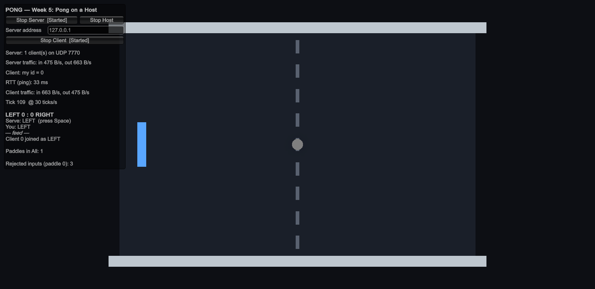

## Step 2 — Start Host, Stop Host, the [Host] line

```csharp
private void StartHost()
{
    _nm.ServerManager.StartConnection();                    // 1. become the server
    _nm.ClientManager.StartConnection("127.0.0.1", port);   // 2. connect a client to it, same process
}

private void StopHost()      // client first, then the server
{
    _nm.ClientManager.StopConnection();
    _nm.ServerManager.StopConnection(true);
}
```

In `OnGUI` the server row is `[Start Server] [Start Host]` while both states are Stopped and `[Stop Server] [Stop Host]` while both are Started. The two flags are read once at the top of `OnGUI`, so a click that changes the state cannot change the layout halfway through.

```csharp
// ConnectionLogger.OnClientState
if (args.ConnectionState == LocalConnectionState.Started && _nm.ServerManager.Started)
    Debug.Log("[Host] This process is the server AND a client. RTT is 0 ms.");
```

One click on Start Host: the same Console as Step 1 and a LEFT paddle. (We kept the sentence of the sheet in the log line; the HUD next to it says 33 ms, see Step 1.)

**Start Server only:**

```
[Server] Starting
[Server] Ball spawned.
[Server] Started
```

No paddle, nobody reads the keyboard, HUD: `Server: 0 client(s)`, `LEFT 0 : 0 RIGHT`, `Serve: LEFT (press Space)`, with no paddle to press it for. `Paddles in All: 0`. That is a dedicated server: the same scripts, nobody playing on it.

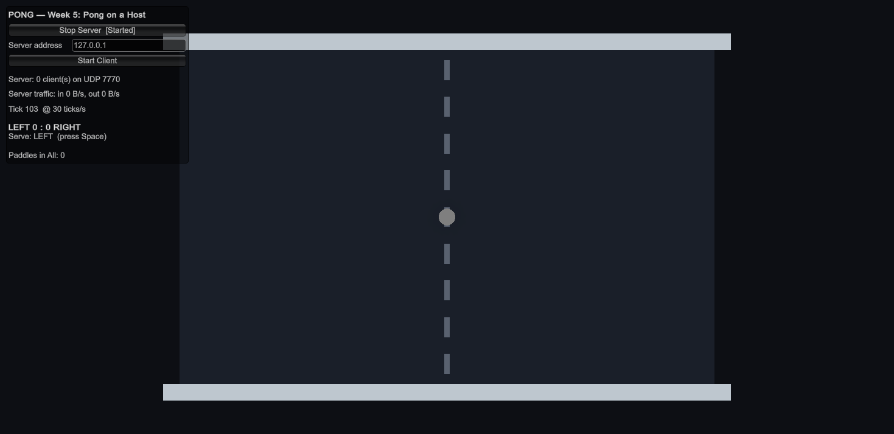

## Step 3 — both callbacks, one paddle

The two lines about the same object, #3:

```
[Server] Spawned paddle #3 for client 0: LEFT. All.Count = 1
[Client] I am client 0, playing LEFT. My paddle is #3. All.Count = 1
```

Both `All.Add` in `PaddleController` already had `if (!All.Contains(this))` from Week 3. We added `All.Count` to both lines and a HUD panel `Paddles in All: N`: host with one paddle → **1**; host + guest → 2; host + guest + spectator → 3.

To see the bug we removed the guard in `OnStartClient` for one run: the server line said `All.Count = 1`, the client line `All.Count = 2`, and the HUD said 2 with one paddle on the court. Nothing else on screen looked different, which is why this bug waits until you print the list. Guard put back.

**Which callback ran first?** `OnStartServer`, run by the **server half**: it spawned the paddle, chose LEFT and wrote `Side`. `OnStartClient` on the same object came one tick later in most runs (33–40 ms; 108 ms once, right after entering Play mode), run by the **client half** when the spawn message reached the host's own client.

## Step 4 — a guest joins

Host in the editor, guest = a development build, Start Client on 127.0.0.1.

- Host: `[Server] Client 1 connected. Clients: 2`, `[Server] Spawned paddle #4 for client 1: RIGHT. All.Count = 2`.
- Guest: `[Client] Authenticated, the server calls me client 1`, `[Client] I am client 1, playing RIGHT. My paddle is #4. All.Count = 2`. HUD `my id = 1`, RTT 0–33 ms (20 ms in the screenshot).
- LEFT (the host) serves first. Rallies, goals; the score is the same in every window.

| Host (editor), later run with a spectator in too | Guest (build), first run |
|---|---|
| 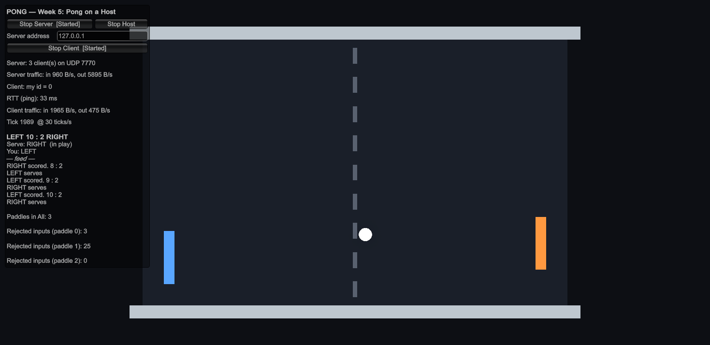 | 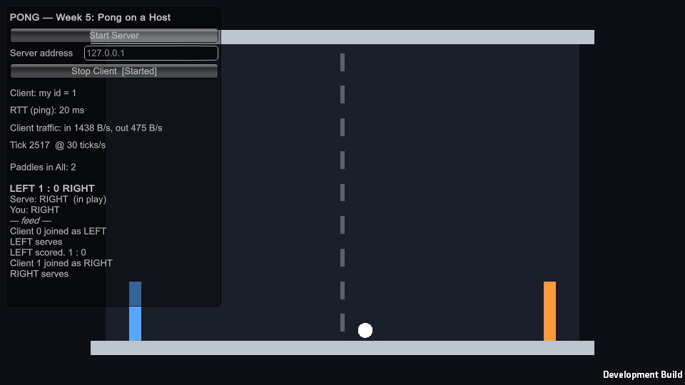 |

## Step 5 — the host wins

Host + guest playing, then a second guest joined as a spectator (client 2, `SPECTATOR`, invisible paddle). About 75 seconds of rallies, tick rate 30, all on one PC:

| | Host (client 0, LEFT) | Guest (client 1, RIGHT) | Spectator (client 2) |
|---|---|---|---|
| RTT on the HUD | always 33 ms (one tick) | 0–33 ms, mean 11 | 0–33 ms, mean 15 |
| key down → **own paddle** starts moving on own screen | **36–67 ms**, mean 52 (53 presses) | **93–186 ms**, median 115 (22 of 23 presses; one took 650 ms) | — |
| Space → ball in play on own screen | 47–71 ms, mean 63 (22 serves) | 43–132 ms (5 serves over three runs) | — |
| bounces where the ball missed the paddle as drawn on that screen | 0 of 24 | 0 of 24 | 0 of 22 |
| frames in which the ball stood still while in play | 0.05 % | 0.5 % | 1.8 % |

What we saw: on the guest the ball never went through a paddle on screen and then bounced. That was the Week 3 picture (our Week 3 README, Step 8, question 3): there the guest drew its own paddle *now* and the ball a few ticks in the past. Since Homework 2 the guest draws its own paddle from the server too, so ball and paddle come from the same server ticks and agree. The delay went into the paddle instead: on the guest its own paddle is late, about twice as late as the host's paddle on the host. The host's paddle on the server *is* the host's paddle: its input is read by its own server one tick later and the host draws the server's transform directly, with no interpolation buffer. The guest's input has to reach the host, the new position has to come back and is then drawn a couple of ticks behind. That is host advantage.

The serve did not show the difference on one PC: the host's ServerRpc also goes through Tugboat on 127.0.0.1 in FishNet 4.7.4 and is read one tick later (47–71 ms), and the guest's packets only cross the same loopback (43–132 ms). Over a real LAN the guest's serve gets its full RTT added; the host's does not.

**Guest's RTT:** 0–33 ms on one PC, mostly 7 ms; 0–20 ms, mostly 7, when it typed the PC's Wi-Fi address instead of 127.0.0.1.

**Tick rate 10** (both host and guest set to 10, about 45 seconds of play): the ball on the guest still glided most of the time (the NetworkTransform interpolates between the fewer snapshots), but everything came later. The guest's own paddle reacted after 141–233 ms (11 presses), the host's own after 102–200 ms, the guest's serve took 199 ms, and the host's HUD said RTT 100 ms (one tick) while the guest's showed 0 (rounded to whole 100 ms ticks). In the worst second the ball stood still in 38 % of the guest's frames (13 % at tick 30), and once in 16 bounces the guest saw the ball bounce 0.09 units past the end of the host's paddle — the only miss in all our runs. Back to **30**.

## Step 6 — the host leaves

**Stop Host mid-rally:** on the guest `[Client] Stopping` and `[Client] Stopped` came within about 70 ms, so there was no timeout. `StopHost` calls `ServerManager.StopConnection(true)`, and `true` sends every client a disconnect message, so the guest knows at once. A timeout would only happen if the host vanished without saying anything (crash, laptop closed, Wi-Fi off). Both paddles, the ball and the score gone from the guest's screen; `Paddles in All: 0`. Start Host again, Start Client again: host client 0, guest client 1, `0 : 0`.

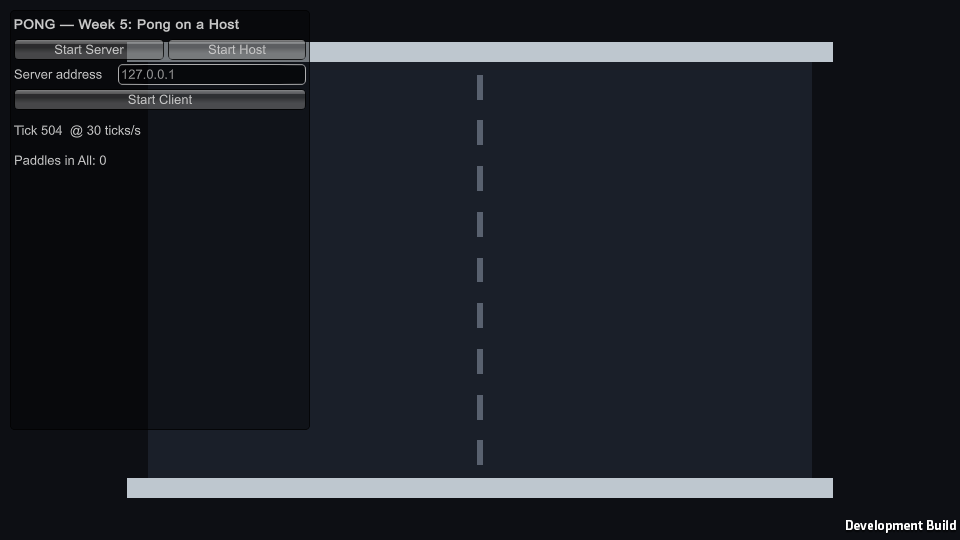

**The guest clicks Stop Client mid-rally (first try, with our Homework 2 code):** host `Client 1 disconnected`, the RIGHT paddle gone… but the ball stayed in play, flew into the empty right goal (LEFT scored, 2 : 0) and the serve went to RIGHT, where nobody was. The host could not serve any more; the game only went on when the guest came back (as client 2, RIGHT; the score was still 2 : 0 because the server never stopped). The same happened with the host alone before anybody joined: one goal, then serve RIGHT, stuck. That is the fix list's "Nobody can serve". The logger also said `Clients: 2` after the disconnect: FishNet calls `OnRemoteConnectionState` before it removes the client from its list.

**Fix** (server only, both in `GameState`):

```csharp
// PaddleController.OnStopServer, after All.Remove(this):
if (Side.Value != Spectator && GameState.Instance != null) GameState.Instance.ServerPlayersChanged();

public void ServerPlayersChanged()
{
    if (!IsServerInitialized || !ServerManager.Started) return;   // the whole server is stopping: nothing to fix
    if (NetworkBall.Instance != null) NetworkBall.Instance.ServerReset();
    HandOverServe();
}

private void HandOverServe()   // also called in Goal()
{
    int side = ServingSide.Value;
    if (SideTaken(side) || !SideTaken(1 - side)) return;
    ServingSide.Value = 1 - side;
    Announce($"Nobody on {PaddleController.SideName(side)}, {PaddleController.SideName(1 - side)} serves");
}
```

**After the fix:** host + guest + spectator, the guest clicks Stop Client while the ball is in play and RIGHT has the serve → host `[Server] Client 1 disconnected. Clients: 2` (host + spectator), RIGHT paddle gone, ball back in the centre, serve RIGHT → LEFT, and the host served again within a second and kept playing alone. A host alone now keeps the serve after its own goals.

## Step 7 — connection card

| Direction | Players | Host's address | ClientId | RTT | Connected first try? |
|---|---|---|---|---|---|
| Editor = host, development build = guest, one PC | — | 127.0.0.1 | guest 1 (host 0) | guest 0–33 ms, mostly 7 · host 33 ms (one tick) | yes |
| Same PC, the guest typed the Wi-Fi IPv4 from `ipconfig` | — | 192.168.1.3 (UDP 7770) | 1 | 0–20 ms, mostly 7 | yes |
| Efe hosts, Bora joins | Efe Can Eser, Bora Deniz Nural | 100.89.114.56 (Efe's Tailscale IP), UDP 7770 | Efe 0, Bora 1 (RIGHT) | Efe 33 ms (one tick) · Bora 50–60 ms | yes |
| Efe hosts, Yusuf joins | Efe Can Eser, Yusuf Arda Göçer | 100.89.114.56 (Efe's Tailscale IP), UDP 7770 | Efe 0, Yusuf 1 (RIGHT) | Efe 33 ms (one tick) · guest HUD 67 ms | yes |
| Bora or Yusuf hosts | — | — | — | — | not done: Pong closes on Bora's and Yusuf's laptops when they start it as a server (same as Week 3), so only Efe's laptop can host |

We live in different districts, so like in Week 3 we used one Tailscale network instead of a LAN (every PC gets a 100.x address). Efe hosted with the Pong build, Bora and Yusuf each typed `100.89.114.56` and clicked Start Client. The guest's paddle moved on both screens, serve and goals worked and the score was the same on both (0 : 0, then 1 : 1). The host's HUD showed `Server: 2 client(s)`, `Paddles in All: 2`, and `Rejected inputs (paddle 1)` went from 13 to 36 during the rallies: over the Internet the guest's honest inputs land in the same server tick more often than on one PC. When the guest left, the host showed `Nobody on RIGHT, LEFT serves`, `Paddles in All: 1` and kept serving and scoring alone (5 : 1); after Stop Host the HUD was back to Start Server / Start Host with `Paddles in All: 0`. So the Step 6 fix also works over the network.

| Guest over Tailscale (client 1, RTT 67 ms) | Host, same moment (client 0, RTT 33 ms) |
|---|---|
| 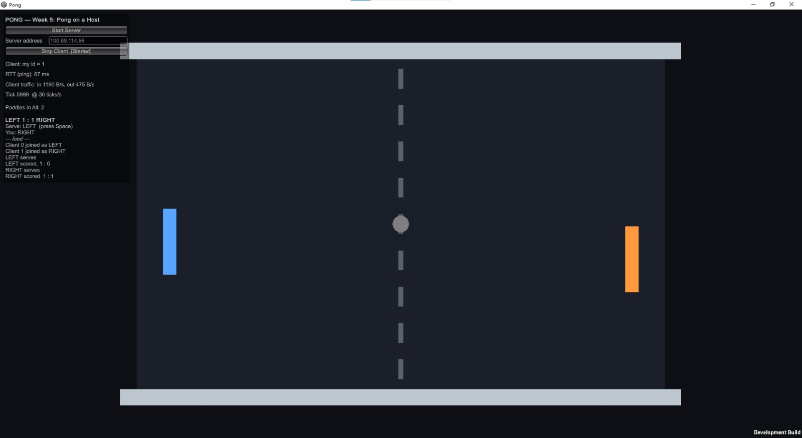 | 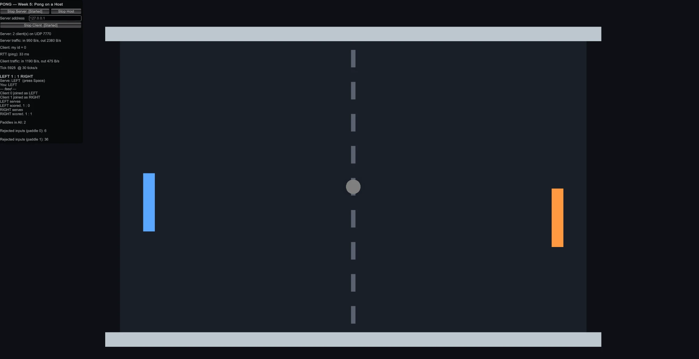 |
| 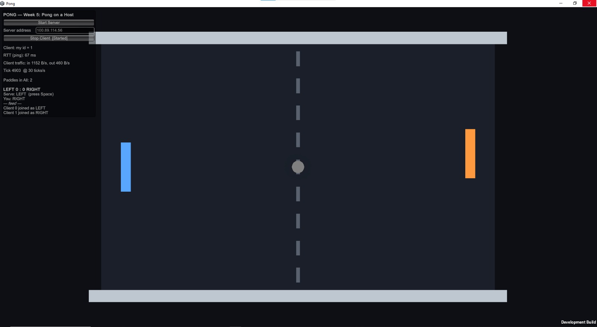 | 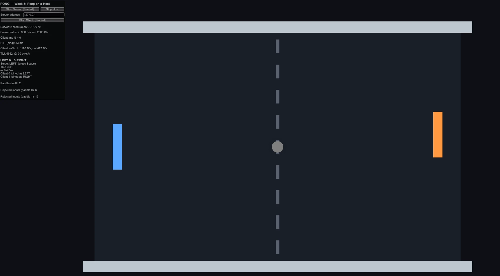 |

| Host after the guest left | Host after Stop Host |
|---|---|
| 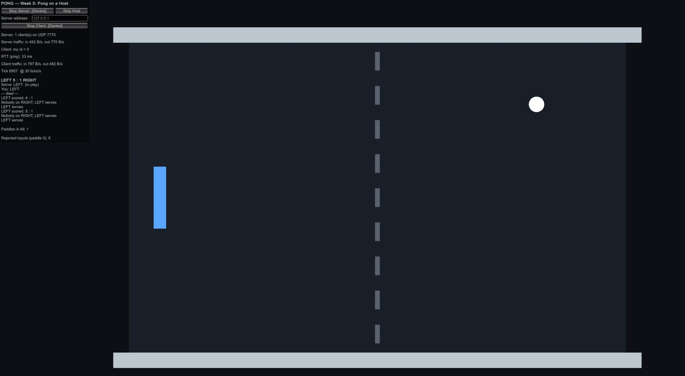 | 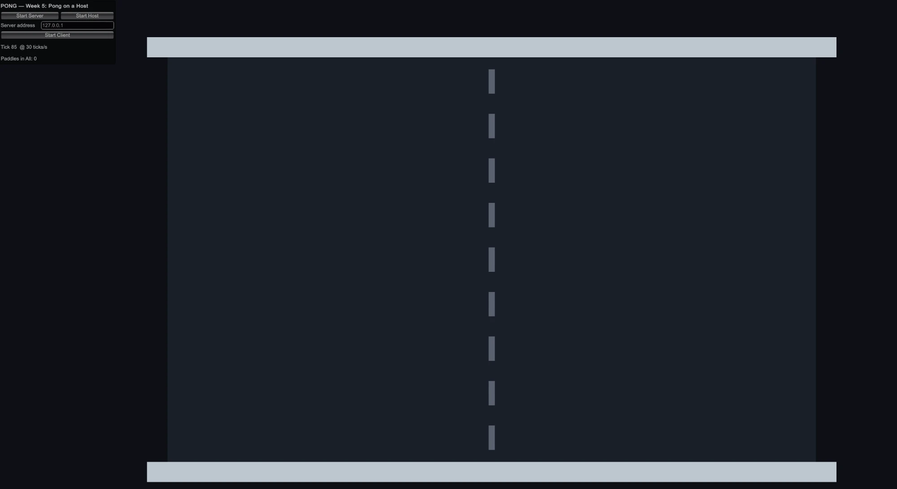 |

Before the partner test we looked at the firewall on Efe's PC, because the fix list's second line is the usual reason a LAN guest cannot connect: Windows had an inbound rule for Unity.exe that allows it only on Domain networks and blocks it on Public, and his home Wi-Fi is set to Public. So a guest on another PC would not reach a host running in my editor until Unity is allowed on Private + Public. The Pong build already has Allow rules for Private + Public, so for the partner test the host runs the build (`Start Host` is in the build's HUD too).

## Step 8 — the same scripts, three ways

1. **Start Server only:** runs `ConnectionLogger` (server lines only), `BallSpawner.OnStartServer` (the ball), the server side of `GameState` and `NetworkBall` (the ball waits for a serve nobody can send) and `PlayerSpawner` (waiting for connections). Does not run: any `OnStartClient`, `PaddleController` at all (no client, no paddle), the keyboard, the client lines of the HUD, `OnChange` with `asServer == false`.
2. **Start Host:** runs twice: `OnStartServer` *and* `OnStartClient` on every networked object (so `PaddleController` adds itself twice without the guard), every SyncVar `OnChange` (`asServer` true and false: `Place()` for `Side`, the ball colour for `InPlay`), the `ConnectionLogger` lines of both halves, `OnStopServer` and `OnStopClient`. Runs once: `OnStartNetwork` (the tick subscription), `Update` (one keyboard), the server logic (`ServerSetAxis`, `ServerRequestServe`, `Goal`).
3. **Start Client:** the guest knows an IP, a port, its own ClientId and whatever the server replicates. The host is just "client 0, LEFT" to it; it cannot tell a host from a dedicated server. The only hint is that the host's paddle is never late.

---

## Self-review

**1. Start Host: which two calls? Why is the host's RTT 0?**
`_nm.ServerManager.StartConnection();` then `_nm.ClientManager.StartConnection("127.0.0.1", port);`, in one process. The host's client and its server share one machine and one clock; nothing crosses a cable, so the real round trip is 0. Our HUD still shows 33 ms: FishNet counts RTT in whole ticks and in 4.7.4 the host's ping goes through Tugboat's socket on 127.0.0.1 and comes back one tick later. Either way the host's number says nothing about the network.

**2. The guest's paddle on the host, the guest and a spectator:**

| | Host | Guest (owner) | Spectator |
|---|---|---|---|
| `IsOwner` | false | **true** | false |
| `IsServerInitialized` | **true** | false | false |
| callbacks that ran | `OnStartServer`, then `OnStartClient` | `OnStartClient` | `OnStartClient` |
| who reads the keyboard for it | nobody on the host (the host's keyboard only drives the host's own paddle) | **the guest**: W/S → `ServerSetAxis` every tick | nobody |

**3. The host presses Space. The guest presses Space.**
Host: Space → `PaddleController.Update` (owner) → `ServerRequestServe()` → the host's own server reads it at the next tick (on 127.0.0.1, no network) → checks (1 s rate limit, `ServingSide`, not in play) → `NetworkBall.Serve` sets `InPlay` → the ball moves in `NetworkBall.Update` on the same machine and the host sees it at once. Measured 47–71 ms.
Guest: Space → `Update` → `ServerRequestServe()` → packet to the host → the same checks → `Serve` → `InPlay` and the ball's positions go back to the guest at the end of the server tick → the guest draws the ball a couple of ticks behind. **The guest waits**: its whole RTT plus the interpolation delay (43–132 ms on one PC; more on a LAN).

**4. Step 6: why did the guest's own paddle vanish when the host stopped? Why did the host's game survive when the guest stopped?**
The guest's paddle was a NetworkObject spawned by the host's server (`PlayerSpawner`). Owning it means the guest may send its input; it does not make the paddle exist. When the server stopped, it told every client to stop, and a client without a server has nothing: paddles, ball and `GameState` are all the server's. When the guest stopped, only one remote connection ended: the server despawned that client's paddle (`OnStopServer` → `ServerPlayersChanged` reset the ball and handed the serve over) and went on, because the server lives inside the host.

**5. State or event?**
the score — **state** (`SyncVar<int>` ×2) · "RIGHT scored!" — **event** (`[ObserversRpc] AnnounceGoal`) · whose serve — **state** (`SyncVar<int> ServingSide`) · "YOU SERVE" — **event** (`[TargetRpc] YouServe`) · the ball's position — **state** (NetworkTransform) · the feed — **state** (`SyncList<string> Feed`).

**6. A guest writes `GameState.Instance.LeftScore.Value = 9`. What happens? Why does it work on the host?**
On the guest FishNet refuses the write: the server is not active in that process and the SyncVar is server-write only, so it logs a "server is not active" warning and the value does not change. The host's server and every other client never hear about it. On the host the same line runs in a process where `IsServerStarted` is true, so it *is* the server writing: the value changes and replicates to everybody. That is why a client-side write "works" on the host and fails on every guest — and why you test from a guest window.

**7. Your feed logs twice on the host. Which line stops a goal sound from playing twice? Why does the score log not double?**
On the host every `OnChange` fires twice, once with `asServer == true` and once with `false`. The line is `if (!asServer)` around the presentation (sound, flash) in the handler, so only the client half plays it. Our Pong has no feed log and no goal sound in an `OnChange` — the feed is drawn from the list every frame and the "scored!" flash is in `AnnounceGoal`, an ObserversRpc that runs once in each client, the host's client half included — so nothing plays twice. Our two `OnChange` handlers that do run twice (`Place()` for `Side`, the ball colour for `InPlay`) set the same position and colour again, which is harmless. The score log does not double because it is written by server code, `GameState.Goal()` → `Announce(...)`, which runs once in the server half; only the change callbacks run in both halves.
