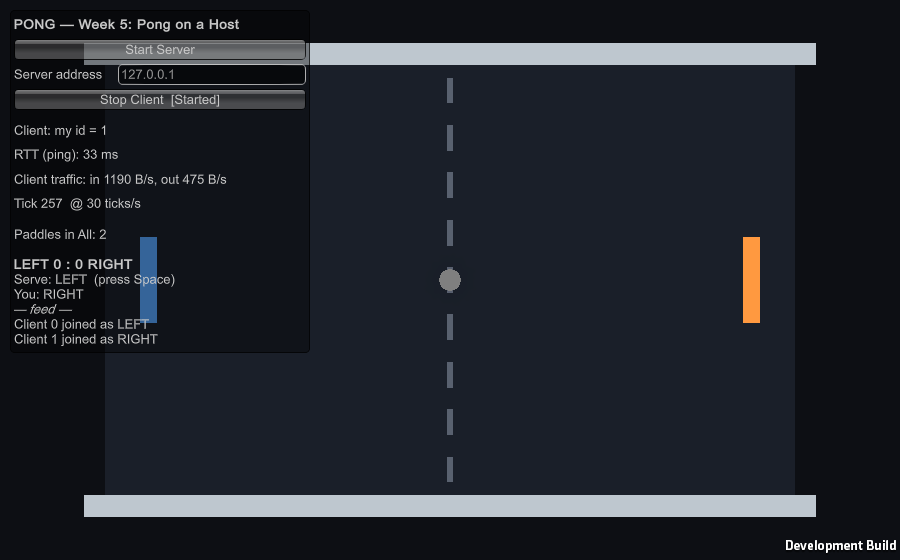

# Week 6 — Homework 3: the host cheats, and the join code

**Team Takla:** Yusuf Arda Göçer · Efe Can Eser · Bora Deniz Nural — Unity 6000.3.2f1 · FishNet 4.7.4 · tick rate 30

Our Homework 2 Pong, on a host. Answers go under each step as we do them.

## Before we start

- [x] Homework 2 works: Client Authoritative off, the 30 ms rate limit, keys C, X, T.
- [x] Start Host and Stop Host from Week 5 work.
- [x] Multiplayer Play Mode: one instance, no `Server` tag (removed in Week 5).

How we tested: on one PC (Efe's), like in Week 5. The main editor was the host and clicked Start Host. The guest was a development build of the same project on 127.0.0.1. We pressed the keys with a small throw-away script that queues key presses into the Input System and writes both windows' Console and positions into a log. It is not in the repo. That way we could press "C, X, T, G" in one window and read exactly what the other one did.

## Step 1 — the guest cheats

New key in `PaddleController.Update`, next to C, X and T:

```csharp
if (kb.gKey.wasPressedThisFrame && GameState.Instance != null)
    GameState.Instance.LeftScore.Value = 9;     // G: score edit, a direct write, no RPC
```

Start Host in the editor, the guest joined on 127.0.0.1 and was RIGHT (client 1). Keys pressed in the guest window, one at a time:

| Key on the guest | Host Console | What both windows showed |
|---|---|---|
| C | 20 lines `[Server] Rejected input from client 1: too fast.` | the guest's paddle moved 0.27 units, which is one tick at speed 8. Same on both windows |
| X | 1 `Rejected input` line | moved 0.26, one tick at normal speed. Never faster |
| T | nothing | the paddle was at (0, 0) for one frame on the guest (about 2 ms, we logged 150 frames), then back at x = 7, z = 3.47. The host's copy never moved |
| G | nothing | score stayed 0 : 0 on both. The guest's own Console had a warning: `Cannot complete operation as server when server is not active.` |

Three small differences from the sheet, all explainable:

- C gave 20 lines, not 19. The spam is 20 inputs in one frame. The first one is accepted (that is the one tick of movement), the other 19 are rejected, and the guest's normal input for that tick arrives in the same tick and is rejected too.
- X gave one line. The X input (50, clamped to 1) and the normal per-tick input landed in the same tick, so one of them was too fast.
- T was much shorter than "jumps, snaps back". We moved the paddle up first so a jump would be visible. It jumped and was back in the very next frame, before any new tick came from the host. Since Homework 2 the guest's paddle is driven by its NetworkTransform and the server resends the position every tick (`ForceSend`), so the NetworkTransform puts the paddle back where the server says on the next frame. On a screenshot you cannot catch it.



**G wrote a SyncVar on the guest. Why did the host never see it?** A SyncVar only goes one way, server to clients. On the guest there is no server running, so FishNet refused the write (that is the warning) and nothing was sent anywhere. Even if the value had changed locally, there is no path from a client's SyncVar up to the server; the only way up is a ServerRpc, and then the server decides.

## Step 2 — one more check: the serve

We already had a 1 s serve limit as an extra in Homework 2, but it was in the wrong place (before the null check) and its RPC could only say one thing. Now it follows the order from the Week 4 notes: well-formed? → too fast? → allowed by the rule? → write state → announce.

```csharp
private const double MinServeGap = 1.0;    // server-only, one per paddle = one per player
private double _lastServeTime = -1;        // instance field, not static

[ServerRpc]
private void ServerRequestServe()
{
    GameState gs = GameState.Instance;                       // well-formed?
    NetworkBall ball = NetworkBall.Instance;
    if (gs == null || ball == null) return;

    double now = TimeManager.TicksToTime(TimeManager.Tick);  // too fast?
    if (_lastServeTime >= 0 && now - _lastServeTime < MinServeGap)
    {
        TargetRefused(Owner, "TOO FAST");
        return;
    }
    _lastServeTime = now;

    if (Side.Value != gs.ServingSide.Value || ball.InPlay.Value) return;   // allowed by the rule?
    ball.Serve(1 - Side.Value);                                            // write state
    GameState.Announce($"{SideName(Side.Value)} serves");                  // announce
}

[TargetRpc]
private void TargetRefused(NetworkConnection target, string why) { ConnectionHud.Flash(why); }
```

What we saw:

- The guest pressed Space twice, 0.15 s apart, while it was LEFT's serve. The guest's HUD flashed TOO FAST about 45 ms after the second press (the refusal has to travel back). The host's HUD stayed empty.
- 0.3 s later the host pressed Space and served normally. So the guest's timestamp did not block the host; each paddle has its own.
- LEFT scored, RIGHT got the serve. The guest waited more than a second, pressed Space and served. Pressed again 0.2 s later: TOO FAST again, only on the guest.

| Guest, right after the second Space | Host, same moment |
|---|---|
|  |  |

The first Space in the first bullet was refused silently (not the guest's serve) but it still set the timestamp. That is on purpose: the rate check comes before the rule check, so a spammer gets told "too fast" whether or not it is their serve.
