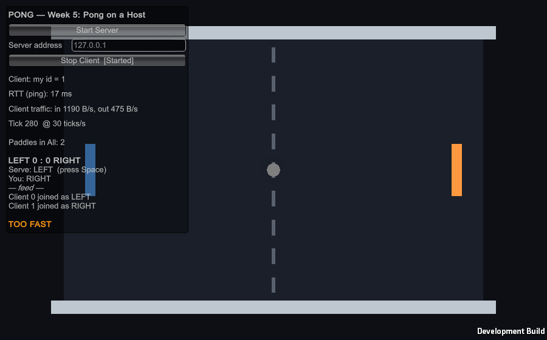
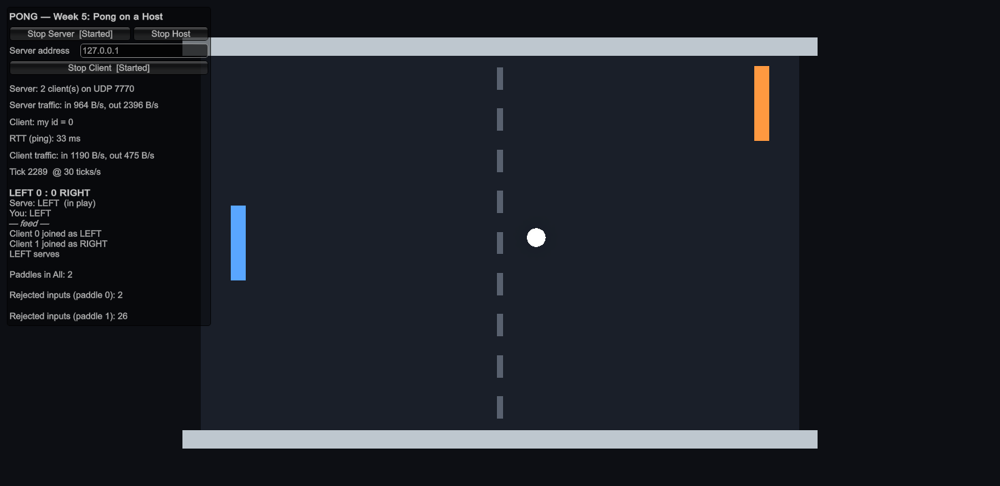
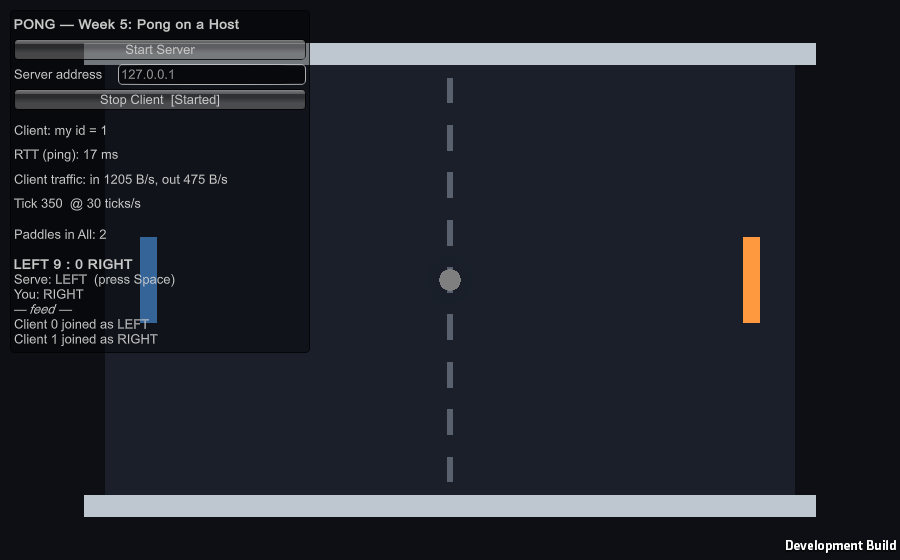
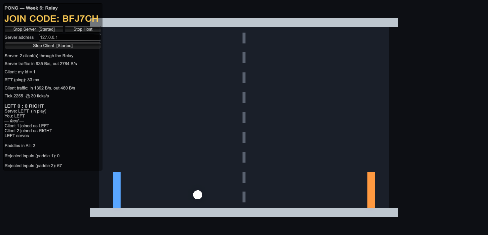
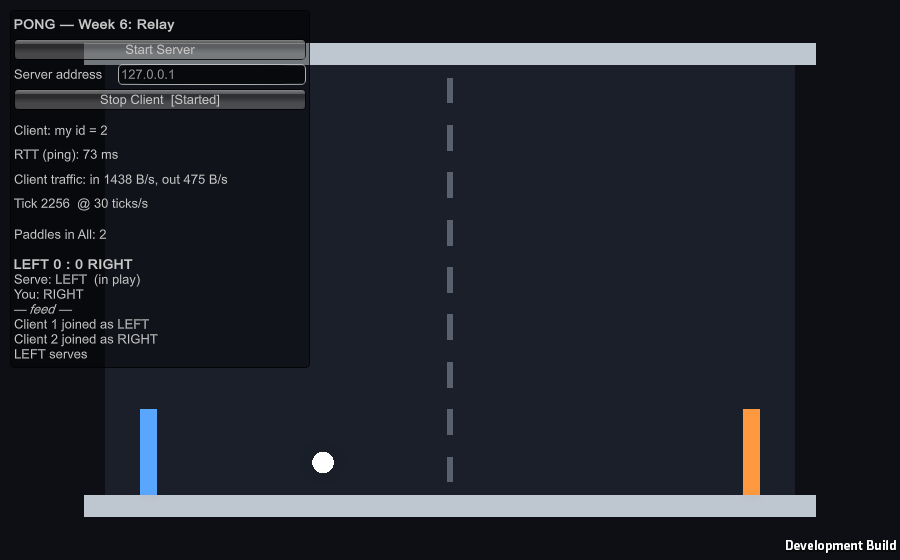

# Week 6 — Homework 3: the host cheats, and the join code

**Team Takla:** Yusuf Arda Göçer · Efe Can Eser · Bora Deniz Nural — Unity 6000.3.2f1 · FishNet 4.7.4 · tick rate 30

Our Homework 2 Pong, on a host. Answers go under each step as we do them.

## Before we start

- [x] Homework 2 works: Client Authoritative off, the 30 ms rate limit, keys C, X, T.
- [x] Start Host and Stop Host from Week 5 work.
- [x] Multiplayer Play Mode: one instance, no `Server` tag (removed in Week 5).

How we tested: on one PC (Efe's), like in Week 5. The main editor was the host and clicked Start Host. The guest was a development build of the same project on 127.0.0.1. We pressed the keys with a small throw-away script that queues key presses into the Input System and writes both windows' Console and positions into a log. It is not in the repo. That way we could press "C, X, T, G" in one window and read exactly what the other one did.

## Step 1 — the guest cheats

New key in `PaddleController.Update`, next to C, X and T:

```csharp
if (kb.gKey.wasPressedThisFrame && GameState.Instance != null)
    GameState.Instance.LeftScore.Value = 9;     // G: score edit, a direct write, no RPC
```

Start Host in the editor, the guest joined on 127.0.0.1 and was RIGHT (client 1). Keys pressed in the guest window, one at a time:

| Key on the guest | Host Console | What both windows showed |
|---|---|---|
| C | 20 lines `[Server] Rejected input from client 1: too fast.` | the guest's paddle moved 0.27 units, which is one tick at speed 8. Same on both windows |
| X | 1 `Rejected input` line | moved 0.26, one tick at normal speed. Never faster |
| T | nothing | the paddle was at (0, 0) for one frame on the guest (about 2 ms, we logged 150 frames), then back at x = 7, z = 3.47. The host's copy never moved |
| G | nothing | score stayed 0 : 0 on both. The guest's own Console had a warning: `Cannot complete operation as server when server is not active.` |

Three small differences from the sheet, all explainable:

- C gave 20 lines, not 19. The spam is 20 inputs in one frame. The first one is accepted (that is the one tick of movement), the other 19 are rejected, and the guest's normal input for that tick arrives in the same tick and is rejected too.
- X gave one line. The X input (50, clamped to 1) and the normal per-tick input landed in the same tick, so one of them was too fast.
- T was much shorter than "jumps, snaps back". We moved the paddle up first so a jump would be visible. It jumped and was back in the very next frame, before any new tick came from the host. Since Homework 2 the guest's paddle is driven by its NetworkTransform and the server resends the position every tick (`ForceSend`), so the NetworkTransform puts the paddle back where the server says on the next frame. On a screenshot you cannot catch it.


**G wrote a SyncVar on the guest. Why did the host never see it?** A SyncVar only goes one way, server to clients. On the guest there is no server running, so FishNet refused the write (that is the warning) and nothing was sent anywhere. Even if the value had changed locally, there is no path from a client's SyncVar up to the server; the only way up is a ServerRpc, and then the server decides.

## Step 2 — one more check: the serve

We already had a 1 s serve limit as an extra in Homework 2, but it was in the wrong place (before the null check) and its RPC could only say one thing. Now it follows the order from the Week 4 notes: well-formed? → too fast? → allowed by the rule? → write state → announce.

```csharp
private const double MinServeGap = 1.0;    // server-only, one per paddle = one per player
private double _lastServeTime = -1;        // instance field, not static

[ServerRpc]
private void ServerRequestServe()
{
    GameState gs = GameState.Instance;                       // well-formed?
    NetworkBall ball = NetworkBall.Instance;
    if (gs == null || ball == null) return;

    double now = TimeManager.TicksToTime(TimeManager.Tick);  // too fast?
    if (_lastServeTime >= 0 && now - _lastServeTime < MinServeGap)
    {
        TargetRefused(Owner, "TOO FAST");
        return;
    }
    _lastServeTime = now;

    if (Side.Value != gs.ServingSide.Value || ball.InPlay.Value) return;   // allowed by the rule?
    ball.Serve(1 - Side.Value);                                            // write state
    GameState.Announce($"{SideName(Side.Value)} serves");                  // announce
}

[TargetRpc]
private void TargetRefused(NetworkConnection target, string why) { ConnectionHud.Flash(why); }
```

What we saw:

- The guest pressed Space twice, 0.15 s apart, while it was LEFT's serve. The guest's HUD flashed TOO FAST about 45 ms after the second press (the refusal has to travel back). The host's HUD stayed empty.
- 0.3 s later the host pressed Space and served normally. So the guest's timestamp did not block the host; each paddle has its own.
- LEFT scored, RIGHT got the serve. The guest waited more than a second, pressed Space and served. Pressed again 0.2 s later: TOO FAST again, only on the guest.

| Guest, right after the second Space | Host, same moment |
|---|---|
|  |  |

The first Space in the first bullet was refused silently (not the guest's serve) but it still set the timestamp. That is on purpose: the rate check comes before the rule check, so a spammer gets told "too fast" whether or not it is their serve.

## Step 3 — the host cheats

Same keys, this time in the host's window (the editor). Then, still in Play, we selected the host's paddle (`Paddle(Clone)`, owner 0) in the Hierarchy and changed Speed from 8 to 40 in the Inspector.

| On the host | Result | Why |
|---|---|---|
| C | 20 `Rejected input from client 0` lines, the paddle moved one tick (0.27) | it is a request. The 30 ms check runs for the host's own inputs too |
| X | 1 rejected line, moved 0.26, normal speed | it is a request. The clamp to ±1 runs |
| T | the host's paddle jumped onto the ball in the middle of the court and stayed there. Same in the guest window | a direct write. On the host, `transform.position` is the server's position, so the next `ForceSend` sends it to everybody |
| G | LEFT 9 : 0 in both windows. The guest had it 20 ms after the key. The feed still ended at "LEFT scored. 2 : 0", no goal for the other 7 points | a direct write. On the host that is the server writing the SyncVar |
| Speed 40 | we held a key for 0.1 s: the host's paddle went 4.00 units (3 ticks, 1.33 per tick), the guest's paddle with Speed 8 went 1.06 (4 ticks, 0.27 per tick). Five times faster, in both windows | the host's numbers are the rules |

Guest window after the host pressed G:



1. C and X go through `ServerSetAxis`, a request that the server checks, and the server checks the host's requests as well; T and G write the state directly, and on the host the state they write is the server's own.
2. The guest saw every cheat that worked (the paddle sitting on the ball, 9 : 0 with no goal in the feed, a paddle crossing the court in a few ticks), but only as normal replicated positions and score, with nothing that marks them as cheats.
3. Ranked with strangers: a dedicated server, because on a host one of the two players runs the rules and can change them, and the other one has no way to check.

## Step 4 — packages and the transport

- Package Manager ▸ Unity Registry ▸ Multiplayer Services ▸ Install. We got 2.5.0, and it pulled in Unity Transport 2.7.4 and a newer Burst (1.8.29).
- Install package from git URL: `https://github.com/ooonush/FishyUnityTransport.git?path=Assets/FishNet/Plugins/FishyUnityTransport`. It shows up as FishyUnityTransport (`com.alven.fishnet.unitytransport` 2.0.0-pre.2).
- Project Settings ▸ Services: the editor was signed in and the project was already linked to our cloud project, so there was nothing to create. Relay is on in the dashboard; the first Host via Relay got a code, which it would not with Relay off.
- `NetworkManager` ▸ Add Component ▸ UnityTransport, Connection Data ▸ Port 7770. TransportManager ▸ Transport = UnityTransport. Tugboat is still on the object, unused.

One problem the fix list does not have. Our first Start Host after the install threw `InvalidOperationException: Burst failed to compile the function pointer Void Receive(...)` and the server never started. Multiplayer Services had updated Burst, and Burst only loads its new compiler after the editor restarts (the Console had a Burst `TypeLoadException` right after the install, which we ignored at first). We closed and reopened Unity and the error was gone.

After the restart: no red lines. Start Host gave a LEFT paddle and the Console now says `Local server is starting for UnityTransport. Listening on port 7770.` The guest (a new build) joined on 127.0.0.1 and got RIGHT. Two things look different from Tugboat:

- UnityTransport numbers the connections from 1. The host is client 1 and the guest client 2 now (with Tugboat it was 0 and 1). Nothing in our code cares which number a player has.
- The guest's RTT on 127.0.0.1 was 0 ms in all 20 samples (Tugboat: 0–33, mostly 7). The host's HUD shows 0 or 33.

Also: when a guest clicks Stop Client, FishyUnityTransport writes a red `Failed to connect to server.` although the guest was connected the whole time. It marks the connection as closed before it handles its own disconnect event, then reads that event as a failed connect. It does no harm, we just don't panic about it anymore.

## Step 5 — RelayLink.cs

[`Pong/Assets/Scripts/Network/RelayLink.cs`](../Pong/Assets/Scripts/Network/RelayLink.cs), typed from Notes 6.1. A static class with two public methods: `StartHostAsync(nm)` returns the join code, `StartGuestAsync(nm, code)` joins with one. It compiled on the first try and nothing called it until Step 6.

We added one thing. Both methods sign in first, the host under the profile `host` and the guest under `guest` (`InitializationOptions.SetProfile`, from the fix list). We test with two windows on one PC, and without profiles they could end up as the same anonymous player.

- `CreateAllocationAsync` returns an `Allocation`: a place reserved for us on one Relay server, with that server's address and port, our allocation ID, a key and the connection data. That is everything the transport needs to sit on the Relay server as the host.
- `GetJoinCodeAsync` returns a string, the six-character join code for that allocation (ours were LKDBDP and BFJ7CH). The guest gives it to `JoinAllocationAsync` and gets the same Relay server back.
- `SetRelayServerData` comes before `StartConnection` because the transport reads it in the moment it starts. Started first, UnityTransport opens a normal socket on port 7770 and never goes to the Relay, so the code would point at a room with nobody in it.

## Step 6 — two buttons and a code

In [`ConnectionHud.cs`](../Pong/Assets/Scripts/Tools/ConnectionHud.cs):

```csharp
private string _joinCode = "";    // what the guest types
private string _relayCode = "";   // the code the host got; shown big while the server runs
private bool _relayBusy;          // a Relay call is running: no buttons, so two clicks cannot book two rooms

private async void HostViaRelay()
{
    _relayBusy = true;
    try { _relayCode = await RelayLink.StartHostAsync(_nm); }
    catch (Exception e) { Debug.LogError($"[Relay] Host failed: {e.Message}"); }
    finally { _relayBusy = false; }
}

private async void JoinViaRelay()
{
    _relayBusy = true;
    try { await RelayLink.StartGuestAsync(_nm, _joinCode); }
    catch (Exception e) { Debug.LogError($"[Relay] Join failed: {e.Message}"); }
    finally { _relayBusy = false; }
}
```

In `OnGUI`, while server and client are both Stopped and `_relayBusy` is false: a Host via Relay button, then a text field for the code (6 characters max) next to a Join via Relay button. While a call runs the buttons are gone and the HUD says `Relay: asking Unity's servers…`; Start Host is hidden then too. While `_relayCode` is not empty and the server is Started, `JOIN CODE: BFJ7CH` sits at the top in 26 pt. Stop Host clears `_relayCode`.

Host (main editor), Host via Relay:

```
[Relay] Signed in as host, player …          0.4 s after the click
[Relay] Join code: BFJ7CH                    2.0 s after the click
[Server] Starting
[Server] Started
[Client] Started
[Host] This process is the server AND a client. RTT is 0 ms.
[Server] Spawned paddle #3 for client 1: LEFT. All.Count = 1
```

Guest (build), code typed, Join via Relay:

```
[Relay] Signed in as guest, player …
[Client] Starting
[Relay] Joined room BFJ7CH, connecting through the Relay
[Client] Started                             1.7 s after the click
[Client] I am client 2, playing RIGHT. My paddle is #4. All.Count = 2
```

FishNet still prints `Server IP is 127.0.0.1, port is 7770` when the guest's client starts. That is only the unused Connection Data on the component; the client really goes to the Relay server.

Then a rally. For 30 seconds both paddles followed the ball (our test script pressed W/S for each window) and LEFT served: 8 paddle hits, no miss, the same 8 hits in the same order in both windows. The guest saw each hit about 150 ms after the host did.

| Host: the code, 2 clients through the Relay | Guest: RIGHT, RTT 73 ms, the ball in play |
|---|---|
|  |  |

Same PC, guest measured both ways:

| | Guest RTT (HUD, 0.5 s samples) | key down → own paddle moves on the guest's screen |
|---|---|---|
| 127.0.0.1, Start Client (Step 4) | 0 ms in all 20 samples | 46–79 ms, median 48 (10 presses) |
| Join via Relay | 40–87 ms, median 67 (30 samples) | 156–183 ms, median 181 (10 presses) |

Nothing else changed between the two rows, so the difference is the trip from our PC to Unity's Relay server and back. During the rally the host's HUD also counted 67 rejected inputs from the guest. Those are honest inputs: the Relay sometimes delivers two of them in the same tick, and our 30 ms rule drops the second one. We saw the same over Tailscale in Week 5.

Two fix-list lines we tried on purpose:

- A code from a host that had just clicked Stop Host: Relay still accepted it (`Joined room BFJ7CH`), but nobody answered. The client stayed at Starting for 60 seconds, then `Failed to connect to server.` (60 connect attempts, 1 s each). So "a code dies with its host" is true, but it can take a minute to show.
- A made-up code (K7PQ2M, the one from the sheet): `[Relay] Join failed: Bad Request: invalid request schema or decoding failure` straight away.

## Step 7 — our partners, from another network

A join code only works inside one Unity cloud project, so the guest has to run our Pong. Bora and Yusuf live in other districts (that is why we used Tailscale in Weeks 3 and 5), so this is the normal case for us. They run a Windows build of this repo's project, the same thing they would get by cloning it and pressing Play, and it carries the same cloud project. Efe hosts with Host via Relay and sends the code on WhatsApp. Bora types it at home and joins, then Yusuf. Then we swap and Bora hosts. In Weeks 3 and 5 Pong closed on Bora's and Yusuf's laptops whenever they started a server, so the swap may fail again; if it does, that goes on the card.

Connection card:

| | |
|---|---|
| Partner's name | Bora Deniz Nural, Yusuf Arda Göçer |
| Who hosted, who joined | Efe hosted (Host via Relay), Bora joined, then Yusuf. Swap: _to fill in_ |
| The two networks | Efe: home Wi-Fi · Bora: _to fill in_ · Yusuf: _to fill in_ |
| Guest RTT through the Relay | _to fill in_ (for comparison: 40–87 ms, median 67, with both windows on Efe's PC) |
| Guest RTT on 127.0.0.1 (Step 6) | 0 ms in all 20 samples (UnityTransport, Start Client on 127.0.0.1) |
| First try? If not, which fix line | _to fill in_ |

Screenshot of the guest window with the RTT and the score: _to add after the test_ (`screenshots/step7_guest.png`).

1. Nobody connects to anybody directly: the host and the guest both open a connection to the same Relay server (the one in the allocation), and the Relay passes every packet on to the other side.
2. Both connections go out from the home network to the Relay, and a home router always lets outgoing traffic and its answers through; nothing has to come in uninvited, so there is no port to forward. It even got around Efe's firewall: Windows blocks incoming traffic to the Unity editor on Public networks (that is what stopped a LAN guest in Week 5), his home Wi-Fi is Public, and the editor still hosted through the Relay without any change.
3. Every packet now makes two trips instead of one, guest → Relay server → host and back the same way, and the Relay server sits in a data centre somewhere on the internet, not in anybody's house. That is where the extra milliseconds come from. On one PC it already took the guest from 0 to 67 ms RTT and its own paddle from 48 to 181 ms; from another city the guest's own line to the Relay comes on top.

## Two words from this week

- **Listen server:** a server that is also a player's game, what Start Host makes. Cheap, nobody has to rent a machine, but the server's rules are on the host's computer, so the host can change them (Step 3).
- **Relay:** a server in the middle that both players connect out to and that forwards their packets. It is how a guest reaches a host behind a home router without an IP or port forwarding (Steps 4–7). It costs latency: one extra trip each way.

## The line we point at

[`RelayLink.cs`, line 30](../Pong/Assets/Scripts/Network/RelayLink.cs#L30):

```csharp
transport.SetRelayServerData(allocation.ToRelayServerData("dtls"));
```

Everything in Part B hangs on this line and on where it is. It gives UnityTransport the Relay room before `StartConnection`. One line later, the code still appears on the HUD but the host is listening on port 7770 and nobody can reach it.
